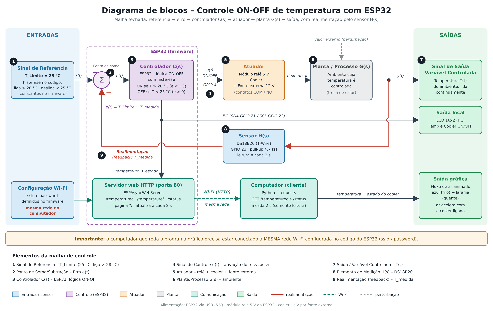
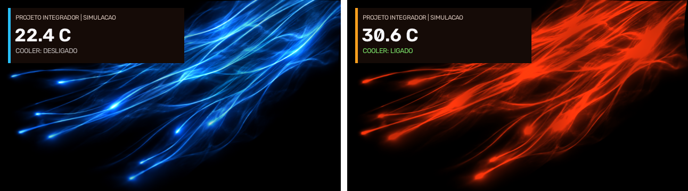

# Monitoramento e Controle de Temperatura com ESP32 + Computação Gráfica

Projeto Integrador (PI) das disciplinas **Sistemas Embarcados, Sistemas de Controle e Computação Gráfica** — UNASP
Prof. Robson Souza, Fabiano Alves e Abraao da Silva

**Integrantes:** _Laís Gonçalves, Sabrina Medina_

## O que o sistema faz

1. Um sensor **DS18B20** mede a temperatura do ambiente e o **ESP32** mostra o valor em um **LCD 16x2**.
2. O ESP32 faz um **controle ON-OFF com histerese**: liga o **cooler** (via módulo relé + fonte externa) quando a temperatura passa de **28 °C** e só desliga abaixo de **25 °C**.
3. O ESP32 publica a temperatura e o estado do cooler por **Wi-Fi** em um servidor web (HTTP).
4. Um programa em **Python** no computador consulta o servidor a cada 2 s e anima um **fluxo de ar luminoso**: azul quando está frio, laranja/vermelho quando esquenta, e o ar acelera quando o cooler está ligado.

> **Importante:** o computador que roda o programa gráfico precisa estar conectado à **mesma rede Wi-Fi** configurada no código do ESP32 (`ssid` / `password`). Em redes diferentes o computador não alcança o IP do ESP32.

## Diagrama de blocos



| # | Elemento | No projeto |
|---|---|---|
| 1 | Sinal de Referência | T_Limite = 25 °C (desliga abaixo de 25 °C, liga acima de 28 °C) |
| 2 | Ponto de Soma/Subtração (Erro) | e(t) = T_Limite − T_medida |
| 3 | Controlador C(s) | ESP32 com lógica ON-OFF e histerese |
| 4 | Sinal de Controle | u(t) = ON/OFF no GPIO 4 → ativa o relé/cooler |
| 5 | Atuador | Módulo relé 5 V + cooler + fonte externa 12 V |
| 6 | Planta/Processo G(s) | Ambiente cuja temperatura está sendo controlada |
| 7 | Saída / Variável Controlada | Temperatura T(t), lida continuamente |
| 8 | Elemento de Medição H(s) | Sensor DS18B20 (1-Wire, GPIO 23) |
| 9 | Realimentação (feedback) | T_medida volta ao ponto de soma |

Lógica do controlador em função do erro (com T_Limite = 25 °C):

- **liga** o cooler quando T > 28 °C, ou seja, e(t) < −3
- **desliga** o cooler quando T < 25 °C, ou seja, e(t) > 0
- entre 25 °C e 28 °C mantém o estado anterior (histerese, evita liga/desliga rápido)

## Computação gráfica



| Situação | O que aparece |
|---|---|
| Frio (até ~23 °C) | fluxo azul, ar lento |
| Esquentando (23 a 30 °C) | a cor passa gradualmente de azul para laranja |
| Quente (acima de ~30 °C) | fluxo laranja/vermelho |
| Cooler ligado | o fluxo de ar acelera |
| Sem conexão / falha | "--.- °C" e "COOLER: SEM DADOS" |

Vídeo do sistema funcionando: [docs/demonstracao.mp4](docs/demonstracao.mp4)

## Estrutura do repositório

```
├── firmware/monitoramento_esp32/   código do ESP32 (Arduino IDE)
├── src/
│   ├── projeto_integrador.py       programa de computação gráfica
│   ├── fluxo_base.png              imagem base da animação
│   └── mock_esp32.py               ESP32 simulado (testar sem o circuito)
├── docs/                           diagrama de blocos, imagens e vídeo
├── .vscode/launch.json             configurações de execução (F5)
└── requirements.txt
```

## Hardware

| Componente | Ligação no ESP32 |
|---|---|
| DS18B20 (dados) | GPIO 23, com resistor pull-up de 4,7 kΩ para 3,3 V |
| Módulo relé (IN) | GPIO 4 (resistor de 10k a 40k em série), VCC em 5 V, GND |
| LCD 16x2 I²C | SDA no GPIO 21, SCL no GPIO 22 |
| Cooler | fonte externa de 12 V, ligado nos terminais COM/NO do relé |

> Se o módulo relé for ativo em nível alto, troque `RELE_LIGADO` e `RELE_DESLIGADO` no firmware.

## 1) Gravando o firmware no ESP32

1. Instale a **Arduino IDE** e o suporte à placa ESP32.
2. Instale as bibliotecas (*Sketch > Include Library > Manage Libraries*): **OneWire** (Paul Stoffregen), **DallasTemperature** (Miles Burton) e **LiquidCrystal I2C**.
3. Instale por *Add .ZIP Library*: **ESPAsyncWebServer** e **AsyncTCP**.
4. Abra `firmware/monitoramento_esp32/monitoramento_esp32.ino` e **troque `ssid` e `password`** pelos da sua rede. Use a mesma rede em que o computador vai estar. Não envie a senha real para o GitHub.
5. Grave no ESP32, abra o *Serial Monitor* (115200) e anote o **endereço IP** mostrado.

Rotas do servidor: `/` (página), `/temperaturec`, `/temperaturef`, `/status`.

## 2) Rodando o programa gráfico

Requer Python 3.9 ou superior. Na pasta do projeto:

```bash
pip install -r requirements.txt
```

No Windows, se tiver mais de um Python instalado, use `py -3.12 -m pip install -r requirements.txt`.

**Modo demonstração (sem o circuito):**

```bash
python src/projeto_integrador.py
```

Arraste a barra de temperatura ou clique em **INICIAR CICLO**.

**Com o ESP32 real** (computador na mesma rede Wi-Fi do ESP32):

```bash
python src/projeto_integrador.py --ip 192.168.0.50
```

Ou abra o programa sem `--ip` e clique em **CONECTAR ESP32**.

**Testando a comunicação sem o circuito:** em um terminal rode `python src/mock_esp32.py`. Em outro, rode `python src/projeto_integrador.py --ip 127.0.0.1:8080`.

**Gerando um vídeo MP4 da animação:** `python src/projeto_integrador.py --video`

No VS Code também dá para apertar **F5** (*Run and Debug*) e escolher a opção desejada.

O programa Python só **lê** os dados do ESP32. Quem comanda o relé é o próprio ESP32.

## Tecnologias

ESP32 · DS18B20 · Arduino (C++) · ESPAsyncWebServer · Python · OpenCV · NumPy · Tkinter · requests
